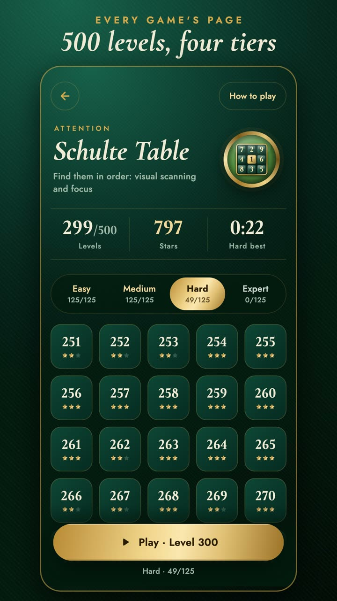
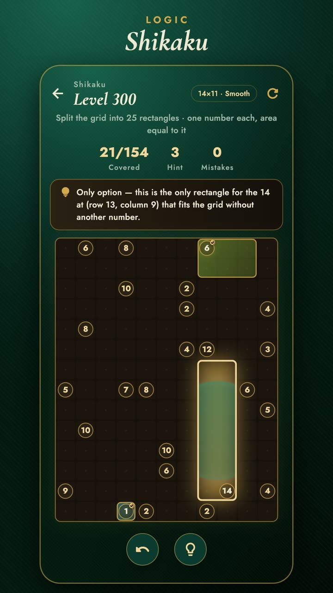
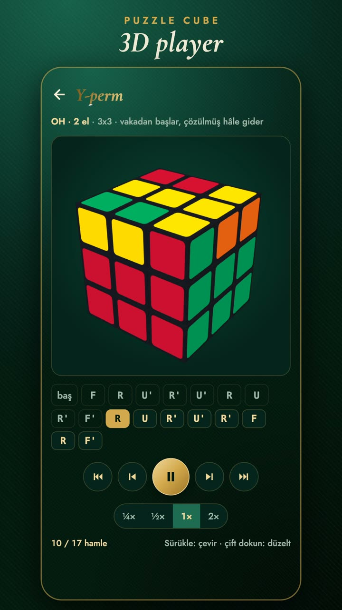

# Clever Place

Clever Place, Android için hazırlanmış bir zekâ ve zihin oyunları koleksiyonu. Mantık bulmacaları, hafıza ve dikkat çalışmaları, tahta oyunları, kıraathane masaları ve zekâ küpü aynı uygulamada toplanıyor. Oyunların kuralları, bölüm üreticileri ve çözücüleri Rust ile yazıldı; arayüz Flutter ile çiziliyor.

Uygulama tamamen çevrimdışı çalışır. Hesap, reklam ya da internet izni yoktur; ilerlemen yalnızca telefonunda saklanır. Arayüz Türkçe ya da İngilizce olabilir (Ayarlar › Dil); dile bağlı içerikler (dersler, kelime listeleri, sözel sorular, Zihin Aşısı mesajları) her iki dilde de Türkçedir.

<p align="center">
  <a href="media/clever_place_tanitim.mp4"></a>
</p>

Tanıtım videosu yukarıda kendiliğinden oynar (3 dakika 57 saniye, sessiz, İngilizce arayüzle). Durdurup ileri geri sarmak için [videoyu oynatıcıda aç](media/clever_place_tanitim.mp4). Video önce bir oyunun sayfasını, ardından o oyunun bir bölümünü sonuna kadar ve bölüm sonu ekranını gösterir; sonra 35 oyunu zor bölümlerinde, en sonda küp sayfalarını ve 3B oynatıcıda bir çözümü gösterir. Kıraathane oyunları videoda yoktur.

<p align="center">
  
  
  
  
  
</p>

Video ve görseller ekran kaydı değildir: uygulamanın ekranları test ortamında kare kare çizilir, oyunları çekirdeğin ipuçları oynar; küpün 3B oynatıcısı (bir web sayfası) tarayıcıda kare kare kaydedilip aynı çerçeveye yerleştirilir. Ana ekrandaki yıldız ve ilerleme sayıları örnek değerlerdir. Yeniden üretmek için: `app/tool/promo/make.sh` (macOS, ffmpeg ve Playwright gerekir; Türkçe çekim için `PROMO_LANG=tr`).

## Neler var

- Her gün seçtiğin kategorilerden birer oyun öneren **Günün hedefi**
- Her oyunun kendi sayfası: bölüm, yıldız ve kademe rekoru; Kolay, Orta, Zor ve Uzman kademeleri; sıradaki bölümü açan düğme. Kurallar ve dersler **Nasıl oynanır** düğmesinin arkasında
- Bölüm sonu ekranı: yıldızlar, süre, hata ve ipucu; aynı kademedeki son on sürenin grafiği ve yeni rekor
- Her oyunda kurallar; çoğunda orta ve ileri seviye dersler
- Birçok oyunda sonsuz, sprint ya da uyarlanır mod
- Türkçe ya da İngilizce arayüz

## Oyunlar

Bu sürümde 7 kategoride **40 oyun** var.

### Strateji (7)

Duvar Yarışı, İtiş, Cırtcak, Surakarta, Düşen Bloklar, Blok Merkezi, Mücevher Birleştir

### Hafıza (7)

N-Back, Hafıza Sarayı, Sayı Dizisi, Corsi Blokları, Eşleştirme, Sahne Hafızası, Kelime Listesi

### Dikkat (10)

Schulte Tablosu, Renk–Kelime, Çoklu Takip, Dur ya da Geç, Renk Kapıları, Görev Değiştirme, İz Sürme, Hızlı Akış, Değişimi Yakala, Dönen Sayılar

### Mantık bulmacaları (8)

Sudoku, Taçlar, Güneş & Ay, Shikaku, Renk Tüpleri, Hanoi Kuleleri, IQ Soruları, Sözel ve Sosyal Zeka

### Zihin antrenmanı (3)

Mental Aritmetik, Soroban (Mental Aritmetik sayfasının içinde), Zihin Aşısı (manipülasyon tekniklerini tanıma)

### Kıraathane oyunları (4)

Batak, Okey (101 ve klasik), Blöf, 21

### Zeka küpü (1)

Küp: zamanlayıcı, algoritma defteri, 3B oynatıcı ve kendini sınama

## İndir

En güncel APK dosyasını [Releases sayfasından](https://github.com/DenizTanisman/clever-place/releases/latest) indirebilirsin. Uygulama 64 bit ARM işlemcili (arm64-v8a) ve Android 7.0 ya da üstü telefonlarda çalışır.

APK nasıl kurulur:

1. Telefonunda Releases sayfasını aç ve `CleverPlace-<sürüm>.apk` dosyasını indir.
2. İndirilen dosyaya dokun.
3. Android "bilinmeyen uygulamalar" uyarısı gösterirse **Ayarlar**'a geç ve dosyayı açtığın uygulama (tarayıcı ya da Dosyalar) için **Bu kaynaktan izin ver** seçeneğini aç.
4. Geri dön ve **Yükle**'ye dokun.
5. Kurulum bitince bu izni istersen yeniden kapatabilirsin.

Play Protect uyarı verirse "Yine de yükle" seçeneğiyle devam edebilirsin. APK, Google Play dışından dağıtıldığı için bu uyarı normaldir.

## Kaynaktan derleme

Gerekenler:

- [Flutter](https://docs.flutter.dev/get-started/install) 3.27 ya da üstü
- [Rust](https://rustup.rs) ve Android hedefi: `rustup target add aarch64-linux-android`
- Android SDK ve NDK 28.2.13676358
- JDK 17 ya da üstü

Adımlar:

```sh
# 1. Rust çekirdeğini derle. Sonuç app/android/app/src/main/jniLibs/ altına kopyalanır.
#    NDK varsayılan yerde değilse önce ANDROID_NDK_HOME değişkenini ayarla.
./core/build_android.sh

# 2. Uygulamayı derle.
cd app
flutter pub get
flutter build apk --release --target-platform android-arm64
```

APK, `app/build/app/outputs/flutter-apk/app-release.apk` yolunda oluşur. `android/key.properties` dosyası yoksa derleme hata ayıklama anahtarıyla imzalanır. Kendi anahtarınla imzalamak için `app/android/key.properties.template` dosyasındaki adımları izle.

Testler:

```sh
(cd app && flutter test)
(cd core && cargo test)
```

## Proje yapısı

| Klasör | İçerik |
| --- | --- |
| `core/` | Rust çekirdeği: oyun kuralları, bölüm üreticileri, çözücüler |
| `app/lib/clever/` | Flutter arayüzü: ana ekran, oyun görünümleri, dersler |
| `app/assets/` | Yazı tipleri, küp verileri, soru bankası, uygulama simgesi |
| `app/tool/` | Küp karıştırma üreteci, soru bankası denetim araçları ve tanıtım videosu üreteci |
| `media/` | Tanıtım videosu ve ekran görselleri |

Uygulama çekirdekle tek bir C işlevi (`cp_call`) üzerinden JSON mesajlarıyla konuşur.

## Üçüncü taraf bileşenler

- [Cormorant](https://github.com/CatharsisFonts/Cormorant) ve [Jost](https://github.com/indestructible-type/Jost) yazı tipleri, SIL Open Font License 1.1 (`app/assets/fonts/OFL-*.txt`)
- [three.js](https://github.com/mrdoob/three.js) r128, MIT lisansı (`app/assets/cube/player/three.js.LICENSE.txt`)

## Lisans

MIT; ayrıntı için [`LICENSE`](LICENSE). Yukarıdaki üçüncü taraf bileşenler kendi lisanslarıyla gelir.
