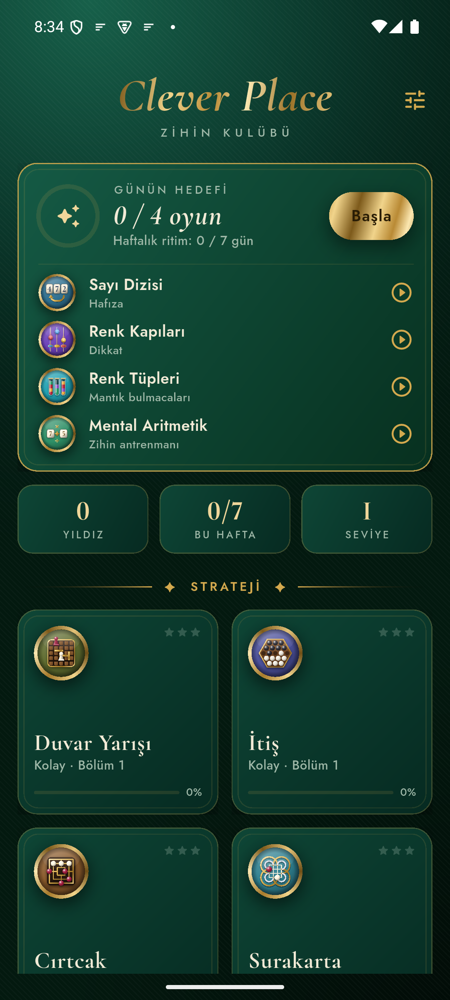
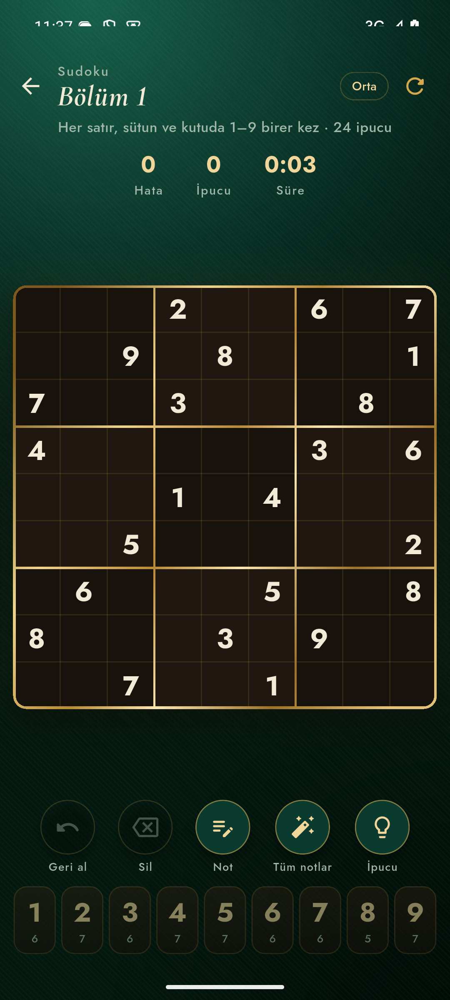
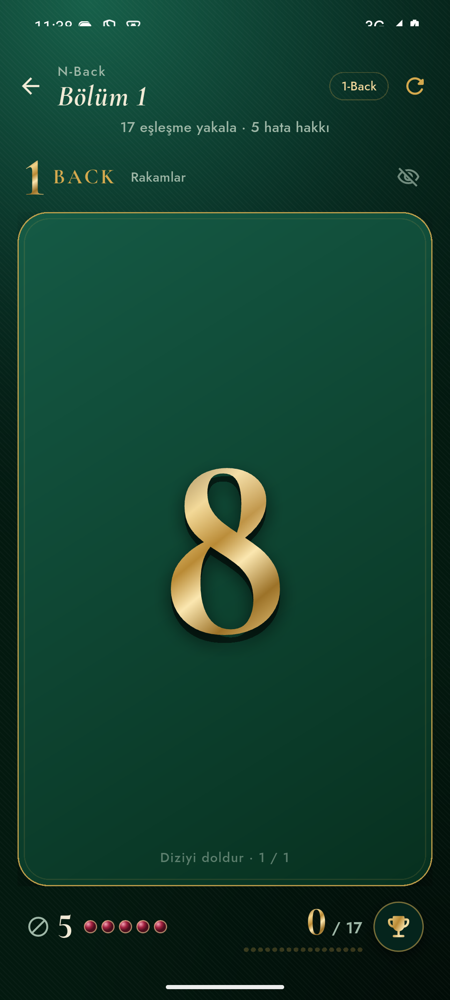
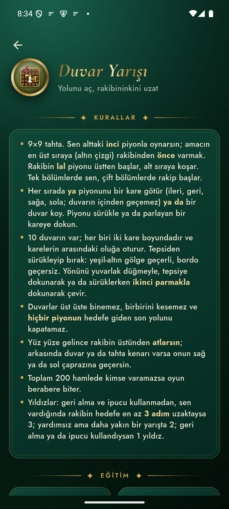
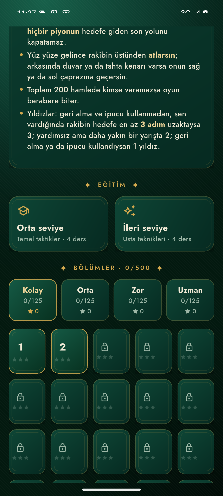

# Clever Place

Clever Place, Android için hazırlanmış bir zekâ ve zihin oyunları koleksiyonu. Mantık bulmacaları, hafıza ve dikkat çalışmaları, tahta oyunları, kıraathane masaları ve zekâ küpü aynı uygulamada toplanıyor. Oyunların kuralları, bölüm üreticileri ve çözücüleri Rust ile yazıldı; arayüz Flutter ile çiziliyor.

Uygulama tamamen çevrimdışı çalışır. Hesap, reklam ya da internet izni yoktur; ilerlemen yalnızca telefonunda saklanır. Arayüz ve oyun içerikleri Türkçedir.

<p>
  
  
  
</p>
<p>
  
  
</p>

## Neler var

- Her gün seçtiğin kategorilerden birer oyun öneren **Günün hedefi**
- Bölümlü oyunlarda Kolay, Orta, Zor ve Uzman kademeleri, yıldızlar ve haftalık ritim takibi
- Her oyunda kurallar; çoğunda orta ve ileri seviye dersler
- Birçok oyunda sonsuz, sprint ya da uyarlanır mod

## Oyunlar

Bu sürümde 7 kategoride **38 oyun** var.

### Strateji (7)

Duvar Yarışı, İtiş, Cırtcak, Surakarta, Düşen Bloklar, Blok Merkezi, Mücevher Birleştir

### Hafıza (7)

N-Back, Hafıza Sarayı, Sayı Dizisi, Corsi Blokları, Eşleştirme, Sahne Hafızası, Kelime Listesi

### Dikkat (9)

Schulte Tablosu, Renk–Kelime, Çoklu Takip, Dur ya da Geç, Renk Kapıları, Görev Değiştirme, İz Sürme, Hızlı Akış, Değişimi Yakala

### Mantık bulmacaları (8)

Sudoku, Taçlar, Güneş & Ay, Shikaku, Renk Tüpleri, Hanoi Kuleleri, IQ Soruları, Sözel ve Sosyal Zeka

### Zihin antrenmanı (2)

Mental Aritmetik, Soroban (Mental Aritmetik sayfasının içinde)

### Kıraathane oyunları (4)

Batak, Okey (101 ve klasik), Blöf, 21

### Zeka küpü (1)

Küp: zamanlayıcı, algoritma defteri, 3B oynatıcı ve kendini sınama

## İndir

En güncel APK dosyasını [Releases sayfasından](https://github.com/DenizTanisman/clever-place/releases/latest) indirebilirsin. Uygulama 64 bit ARM işlemcili (arm64-v8a) ve Android 7.0 ya da üstü telefonlarda çalışır.

APK nasıl kurulur:

1. Telefonunda Releases sayfasını aç ve `CleverPlace-<sürüm>.apk` dosyasını indir.
2. İndirilen dosyaya dokun.
3. Android "bilinmeyen uygulamalar" uyarısı gösterirse **Ayarlar**'a geç ve dosyayı açtığın uygulama (tarayıcı ya da Dosyalar) için **Bu kaynaktan izin ver** seçeneğini aç.
4. Geri dön ve **Yükle**'ye dokun.
5. Kurulum bitince bu izni istersen yeniden kapatabilirsin.

Play Protect uyarı verirse "Yine de yükle" seçeneğiyle devam edebilirsin. APK, Google Play dışından dağıtıldığı için bu uyarı normaldir.

## Kaynaktan derleme

Gerekenler:

- [Flutter](https://docs.flutter.dev/get-started/install) 3.27 ya da üstü
- [Rust](https://rustup.rs) ve Android hedefi: `rustup target add aarch64-linux-android`
- Android SDK ve NDK 28.2.13676358
- JDK 17 ya da üstü

Adımlar:

```sh
# 1. Rust çekirdeğini derle. Sonuç app/android/app/src/main/jniLibs/ altına kopyalanır.
#    NDK varsayılan yerde değilse önce ANDROID_NDK_HOME değişkenini ayarla.
./core/build_android.sh

# 2. Uygulamayı derle.
cd app
flutter pub get
flutter build apk --release --target-platform android-arm64
```

APK, `app/build/app/outputs/flutter-apk/app-release.apk` yolunda oluşur. `android/key.properties` dosyası yoksa derleme hata ayıklama anahtarıyla imzalanır. Kendi anahtarınla imzalamak için `app/android/key.properties.template` dosyasındaki adımları izle.

Testler:

```sh
(cd app && flutter test)
(cd core && cargo test)
```

## Proje yapısı

| Klasör | İçerik |
| --- | --- |
| `core/` | Rust çekirdeği: oyun kuralları, bölüm üreticileri, çözücüler |
| `app/lib/clever/` | Flutter arayüzü: ana ekran, oyun görünümleri, dersler |
| `app/assets/` | Yazı tipleri, küp verileri, soru bankası, uygulama simgesi |
| `app/tool/` | Küp karıştırma üreteci ve soru bankası denetim araçları |

Uygulama çekirdekle tek bir C işlevi (`cp_call`) üzerinden JSON mesajlarıyla konuşur.

## Üçüncü taraf bileşenler

- [Cormorant](https://github.com/CatharsisFonts/Cormorant) ve [Jost](https://github.com/indestructible-type/Jost) yazı tipleri, SIL Open Font License 1.1 (`app/assets/fonts/OFL-*.txt`)
- [three.js](https://github.com/mrdoob/three.js) r128, MIT lisansı (`app/assets/cube/player/three.js.LICENSE.txt`)
