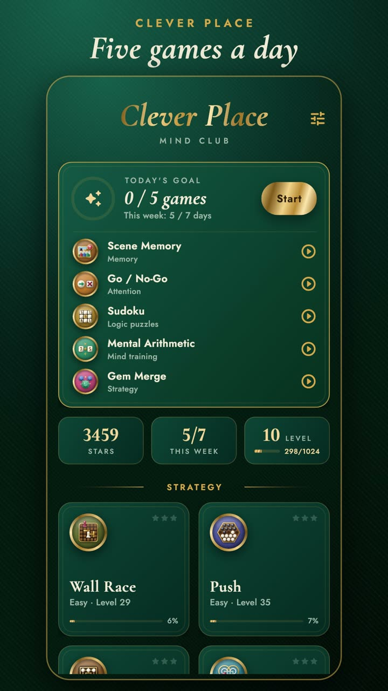
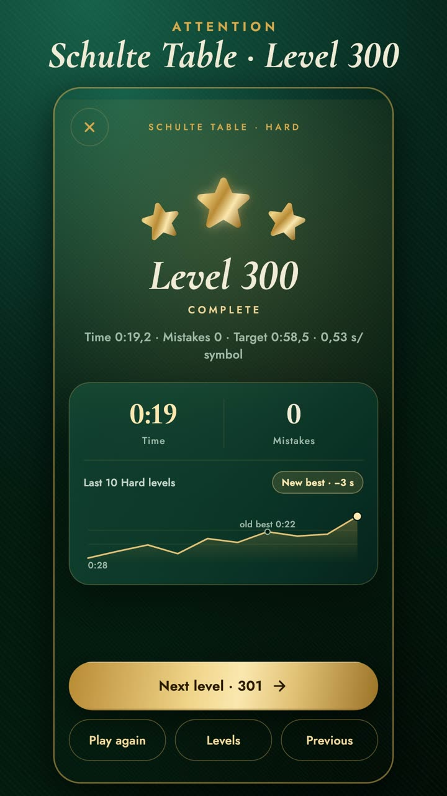

# Clever Place

Clever Place is a collection of brain and mind games for Android. Logic puzzles, memory and attention training, board games, coffeehouse tables and a puzzle cube all live in one app. The game rules, level generators and solvers are written in Rust; the interface is drawn with Flutter.

The app works fully offline. There is no account, no ads and no internet permission; your progress is stored only on your phone. The interface can be Turkish or English (Settings › Language); language-bound content (lessons, word lists, verbal questions, Mind Vaccine messages) stays Turkish in both.

<p align="center">
  <a href="media/clever_place_tanitim.mp4"></a>
</p>

The promo video above plays by itself (3 minutes 57 seconds, silent, English interface). To pause and scrub, [open the video in a player](media/clever_place_tanitim.mp4). It first shows a game's page, then one of that game's levels played to the end along with the level end screen; then 35 games on hard levels, and finally the cube pages and a solution in the 3D player. The coffeehouse games are not in the video.

<p align="center">
  
  
  
  
  
</p>

The video and images are not screen recordings: the app's screens are rendered frame by frame in a test environment and the games are played by the core's hints; the cube's 3D player (a web page) is recorded frame by frame in a browser and placed in the same frame. The star and progress numbers on the home screen are sample values. To regenerate: `app/tool/promo/make.sh` (macOS; needs ffmpeg and Playwright; `PROMO_LANG=tr` for a Turkish take).

## What's inside

- **Today's goal**, which suggests one game a day from each category you choose
- A page for every game: level, stars and tier record; Easy, Medium, Hard and Expert tiers; a button that opens the next level. Rules and lessons sit behind the **How to play** button
- Level end screen: stars, time, mistakes and hints; a chart of the last ten times in the same tier, and new records
- Rules for every game; intermediate and advanced lessons for most
- Endless, sprint or adaptive modes in many games
- Turkish or English interface

## Games

This release has **40 games** in 7 categories.

### Strategy (7)

Wall Race, Push, Nine Men's Morris, Surakarta, Falling Blocks, Block Grid, Gem Merge

### Memory (7)

N-Back, Memory Palace, Digit Span, Corsi Blocks, Pairs, Scene Memory, Word List

### Attention (10)

Schulte Table, Color–Word, Multiple Object Tracking, Go / No-Go, Color Gates, Task Switching, Trail Making, Rapid Stream, Spot the Change, Spinning Numbers

### Logic puzzles (8)

Sudoku, Crowns, Sun & Moon, Shikaku, Color Tubes, Tower of Hanoi, IQ Puzzles, Verbal & Social Intelligence

### Mind training (3)

Mental Arithmetic, Soroban (inside the Mental Arithmetic page), Mind Vaccine (recognizing manipulation techniques)

### Coffeehouse games (4)

Batak, Okey (101 and classic), Bluff, Blackjack

### Puzzle cube (1)

Cube: timer, algorithm notebook, 3D player and self-testing

## Download

Get the latest APK from the [Releases page](https://github.com/DenizTanisman/clever-place/releases/latest). The app runs on phones with a 64-bit ARM processor (arm64-v8a) and Android 7.0 or later.

How to install the APK:

1. Open the Releases page on your phone and download `CleverPlace-<version>.apk`.
2. Tap the downloaded file.
3. If Android shows an "unknown apps" warning, go to **Settings** and turn on **Allow from this source** for the app you opened the file with (your browser or Files).
4. Go back and tap **Install**.
5. Once it is installed, you can turn that permission off again if you like.

If Play Protect warns you, continue with "Install anyway". This warning is normal because the APK is distributed outside Google Play.

## Building from source

Requirements:

- [Flutter](https://docs.flutter.dev/get-started/install) 3.27 or later
- [Rust](https://rustup.rs) and the Android target: `rustup target add aarch64-linux-android`
- Android SDK and NDK 28.2.13676358
- JDK 17 or later

Steps:

```sh
# 1. Build the Rust core. The output is copied to app/android/app/src/main/jniLibs/.
#    If the NDK is not in its default location, set ANDROID_NDK_HOME first.
./core/build_android.sh

# 2. Build the app.
cd app
flutter pub get
flutter build apk --release --target-platform android-arm64
```

The APK is written to `app/build/app/outputs/flutter-apk/app-release.apk`. If there is no `android/key.properties` file, the build is signed with the debug key. To sign with your own key, follow the steps in `app/android/key.properties.template`.

Tests:

```sh
(cd app && flutter test)
(cd core && cargo test)
```

## Project structure

| Folder | Contents |
| --- | --- |
| `core/` | Rust core: game rules, level generators, solvers |
| `app/lib/clever/` | Flutter interface: home screen, game views, lessons |
| `app/assets/` | Fonts, cube data, question bank, app icon |
| `app/tool/` | Cube scramble generator, question bank checking tools and promo video generator |
| `media/` | Promo video and screenshots |

The app talks to the core through a single C function (`cp_call`) using JSON messages.

## Third-party components

- [Cormorant](https://github.com/CatharsisFonts/Cormorant) and [Jost](https://github.com/indestructible-type/Jost) fonts, SIL Open Font License 1.1 (`app/assets/fonts/OFL-*.txt`)
- [three.js](https://github.com/mrdoob/three.js) r128, MIT license (`app/assets/cube/player/three.js.LICENSE.txt`)

## License

MIT; see [`LICENSE`](LICENSE) for details. The third-party components above come with their own licenses.
